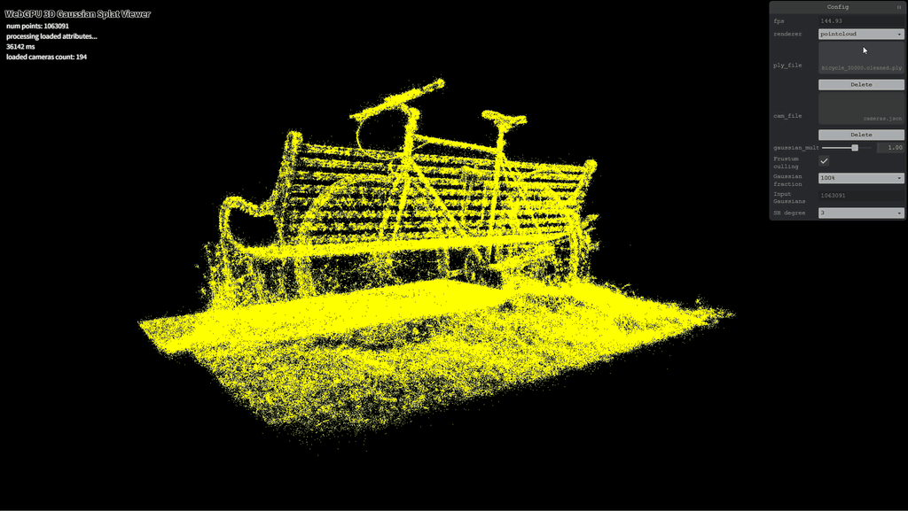
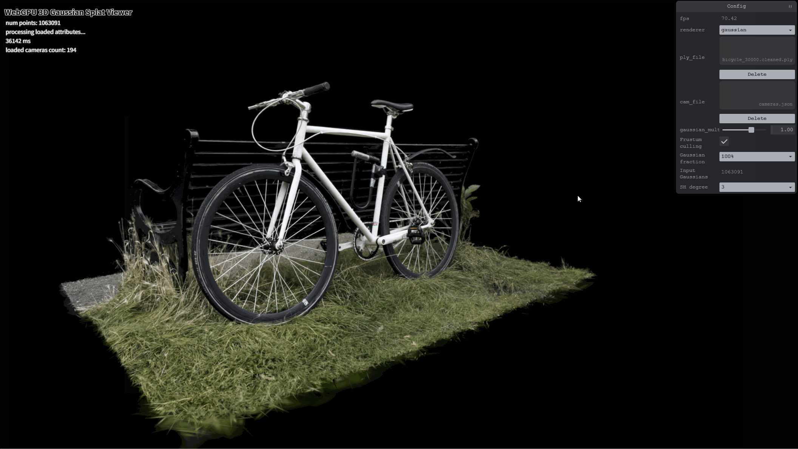
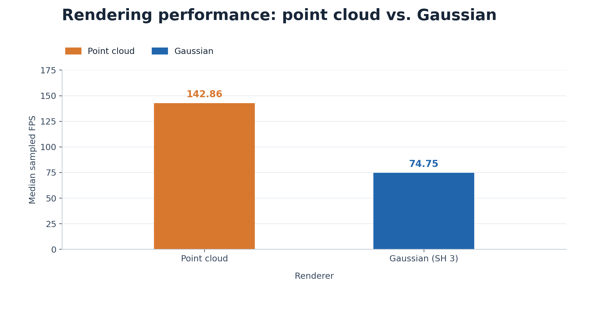
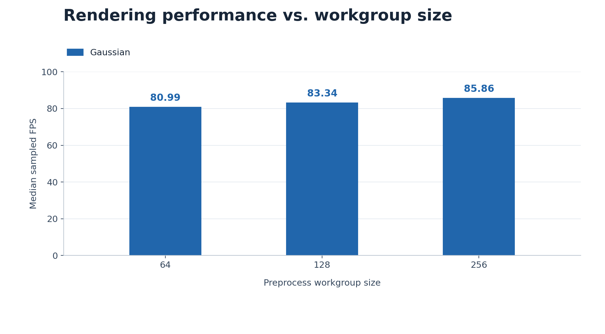
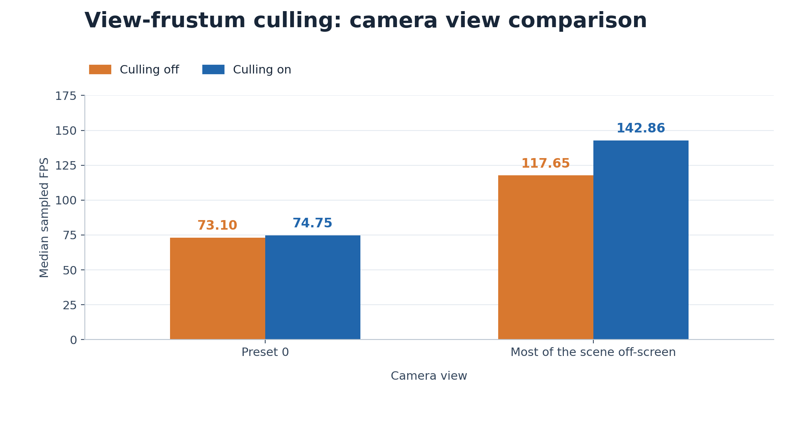
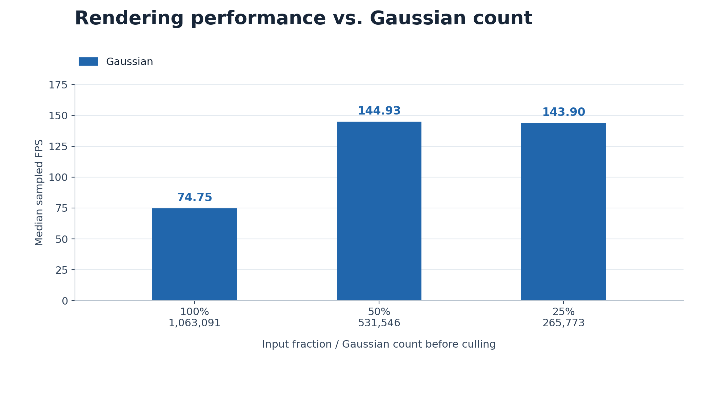

# WebGPU 3D Gaussian Splat Viewer

**Zi Yang** · [LinkedIn](https://www.linkedin.com/in/zi-yang-3359653b2/)\
University of Pennsylvania · CIS 5650 · Project 5

A WebGPU viewer for pretrained 3D Gaussian scenes, with GPU preprocessing, depth sorting, and alpha-blended splats.

**Live Demo:** [GitHub Pages](https://guoren0830.github.io/Project5-WebGPU-Gaussian-Splat-Viewer/)



## Features

- Point-cloud rendering with view and projection transforms
- 3D covariance projection and elliptical Gaussian opacity
- Frustum culling, atomic compaction, GPU radix depth sorting, and indirect drawing
- Adjustable splat scale, SH degree 0–3, and 100% / 50% / 25% Gaussian counts



## Running

```bash
npm ci
npm run dev
```

Use a WebGPU-capable browser. Load a Gaussian PLY and its matching `cameras.json`, then select `gaussian`. [Scene files](https://drive.google.com/drive/folders/1Fz0QhyDU12JTsl2e7umGi5iy_V9drrIW?usp=sharing) are loaded locally; `data/` is excluded from Git and the deployed site.

Left-drag to rotate, right-drag to pan, scroll to move, and press 0–9 for camera presets.

## Test Environment

Windows 11 · AMD Ryzen 9 7845HX · 16 GB RAM\
NVIDIA GeForce RTX 4060 Laptop GPU + AMD Radeon integrated graphics\
VS Code 1.143.1 integrated browser. The active WebGPU adapter was not recorded.

## Performance Analysis

Scene: `bicycle_30000.cleaned.ply`, **1,063,091 Gaussians**. Gaussian tests use SH degree 3, scale 1.0, camera preset 0, culling on, and preprocess workgroup size 256 unless varied.

Charts show median FPS; tables list medians and ranges. Each setting uses six sampled readings from the original FPS display after warm-up, except the point-cloud renderer and mostly off-screen view, which use three. These are sampled FPS readings, not average FPS or GPU timings. Window size stays fixed within each comparison. Workgroup tests were collected in a separate session.

### Point Cloud vs. Gaussian



The point-cloud renderer shows yellow discrete points. Gaussian splats recover scene colors and form smoother, more continuous surfaces through elliptical footprints and alpha blending. They also add covariance projection, SH evaluation, sorting, and blending work.

### Workgroup Size



| Preprocess workgroup size | Median FPS | Sampled FPS range |
|---:|---:|---:|
| 64 | 80.99 | 73.53–86.96 |
| 128 | 83.34 | 75.76–84.75 |
| 256 | 85.86 | 74.07–87.72 |

Larger workgroups had slightly higher medians, but the ranges overlap. Increasing the group size reduces the number of dispatched groups while keeping roughly the same total invocations. Only preprocessing changes; sorting and rasterization still contribute to frame time. These samples do not establish a clear winner.

### View-Frustum Culling



| View | Culling on: median FPS (range) | Culling off: median FPS (range) |
|:---|---:|---:|
| Preset 0 | 74.75 (71.94–80.65) | 73.10 (66.23–80.65) |
| Most of the scene off-screen | 142.86 (140.85–142.86) | 117.65 (90.09–117.65) |

The preset-0 readings overlap, so the gain is unclear. Culling helps more when most Gaussians are off-screen: early rejection skips later preprocessing and reduces sorting and drawing work. The toggle controls the NDC bounds test; the behind-camera check remains enabled.

### Number of Gaussians



| Input fraction | Input Gaussians | Median FPS | Sampled FPS range |
|---:|---:|---:|---:|
| 100% | 1,063,091 | 74.75 | 71.94–80.65 |
| 50% | 531,546 | 144.93 | 131.58–172.41 |
| 25% | 265,773 | 143.90 | 142.86–147.06 |

Halving the input count substantially improves FPS by reducing preprocessing, sorting, and drawing work. The 25% case stays near 144 FPS, possibly limited by display scheduling or fixed overhead, while losing more coverage and detail.

The three fractions use sampling strides of 1, 2, and 4. Counts are before culling; allocated buffer capacity is unchanged.

## References & Acknowledgments

- [CIS 5650 starter code](https://github.com/CIS5650-Fall-2026/Project5-WebGPU-Gaussian-Splat-Viewer): scene loading, camera/UI scaffolding, radix sorter, and SH evaluation.
- [3D Gaussian Splatting for Real-Time Radiance Field Rendering](https://repo-sam.inria.fr/fungraph/3d-gaussian-splatting/) and [Gaussian Splatting Notes](https://github.com/kwea123/gaussian_splatting_notes).
- Libraries: Vite, Tweakpane, tweakpane-plugin-file-import, wgpu-matrix, and @petamoriken/float16.
